# avamux

Terminals, watches, events, a dashboard, logs, a wiki and git repositories in one Avalonia window, with a CLI
that can do everything the window can. Runs on Linux and macOS.

## Build and run

```sh
dotnet build
dotnet run --project src/Avamux          # start the app (a second start just brings the first to the front)
dotnet test                              # core test suite
```

The built executable is `src/Avamux/bin/Debug/net10.0/avamux`; put it (or a `dotnet publish` output) on your
`PATH` to use the CLI as `avamux`.

Linux needs WebKitGTK 4.1 (`libwebkit2gtk-4.1`). macOS uses the system WKWebView.

## Pages

| Page | What it does |
|---|---|
| Terminals | Tabbed terminals (xterm.js on a real pty). Tabs show what is running, or a name you give them (double-click), and a marker for what the terminal is doing: idle, running, an AI agent working, an AI agent waiting for input, or ended. Tabs can be moved to their own window and back (right-click, or the button at the end of the tab strip). Right-click → Split Right / Split Down starts a terminal beside or below the one you are typing in, in the same folder, as a pane of the same tab; drag the dividers between panes to resize them (double-click one to even it out). Panes without the keyboard are dimmed, the tab shows the pane you last typed in and how many it has, and its menu can even the panes out, move one to a tab of its own or close one. Closing the tab closes all its panes; Ctrl+Shift+W in a pane closes just that pane. `avamux terminal split [id] [--down]` does the same from the command line (run in a terminal, it splits that one). Ctrl+Shift+C / V copy and paste, Ctrl+Shift+T / W new and close tab, Ctrl+PageUp / PageDown switch tabs, Ctrl+Shift+L opens or hides the tab's browser. Every other key combination goes to the program. A browser can sit beside each tab, for you and for the AI agent in it: see [Browser panes](#browser-panes). |
| Search | One box over wiki pages, events, watches, terminals, repositories, logs and settings. Pick which sources to include; click a result to open it where it lives. |
| Today | Opens today's daily note in the wiki, creating it if needed. The name comes from `wiki.dailyNoteFormat` (default `yyyy-MM-dd dddd`, e.g. `2026-11-12 Thursday.md`) and `wiki.dailyNoteFolder` (default `Daily`). |
| Settings | Every setting, which file it comes from, and which file to save changes to. Includes themes, the navigation bar style and the AI Workloads switches, and a Hotkeys list of every key avamux handles, page by page. |
| Watching | Periodic checks with a status, summary, clickable/editable link and item list. |
| Events | Timers, scheduled tasks and calendar events (multi-day, weekdays, weekly, monthly, yearly, fixed interval) that can run a script on start and on end. Events can have a location, file attachments, a colour and a markdown description. Month, Week and Day views; in Week and Day, events sit at their hours and overlapping ones share the column. A "Running now" section above the day's list shows events in progress and event scripts still running (with a Stop button). Skip a single occurrence of a repeating event (a holiday, a cancelled session) by right-clicking it on the calendar; skipped dates are listed in the editor, where they can be brought back. Double-click an event on the calendar to edit it, or an empty spot to add one. |
| Dashboard | Your own HTML/CSS/JS from the dashboard folder, with developer tools, an Edit button that opens the folder in your editor, togglable extra CSS/JS sources, and `window.avamux` to control the app. |
| Logs | App logs, crash reports, history of ended terminals, script output; retention by size (200 MB), age and count. |
| Wiki | Markdown editor (coloured to match the theme, with undo/redo) and live preview with folders, links (`[[Page]]`), front matter, syntax-highlighted code blocks (with a copy button) and pictures. Edits are saved automatically after `wiki.autoSaveSeconds` without a change (`wiki.autoSave`). Paste a picture or drop any file onto a page: it is saved next to the page and linked. Click a picture to zoom and pan; right-click it for Show in Folder, Copy and Copy Path. Also previews images, PDFs, audio, video, text files, CSV/TSV (as tables) and zip archives (as a listing), and opens anything else in its default app. Pictures, PDFs and recordings over `wiki.clickToPreviewMegabytes` (20) wait behind a "Load preview" button, and audio and video never start loading until played. Back and Forward buttons (also Alt+Left/Right and the mouse's side buttons) walk through the last 50 pages and files viewed. Entries can be opened in their own window. The last scroll position of recent files is remembered (`ui-state.json` in the data folder). The **Git** button keeps the wiki's history: commit, branches, history, and earlier versions of a page. See [The wiki in git](#the-wiki-in-git). |
| Repos | Changes, history, branches and pull requests for one configured git repository or all of them. Stage or unstage files, hunks (right-click the coloured strip) or single lines (right-click a line number); diff or whole-file view; switch branches; inspect a commit file by file; cherry-pick, revert, reset, tag. Resolve merge conflicts in a three-way merge tool (see below). |
| Git Activity | Where the work is going across hundreds of repositories: whole GitHub organisations, Azure DevOps organisations or projects, folders of clones, single URLs. Heatmaps you can pivot by anything (repositories, contributors, branches, languages, file types, frameworks, AI tools and models, days, weeks, weekdays, hours), leaderboards with trends, working rhythm, AI use, frameworks and languages, and the commits themselves. See [Git Activity](#git-activity). |
| C# Interactive | A C# prompt that runs inside the running avamux, next to a screen of live controls built from XAML and from the C# you type. See [C# Interactive](#c-interactive). |
| Caffeine | Keeps the computer awake until you turn it off, for a while (15 minutes to 8 hours, a length such as `1h30m`, or until a clock time), or while terminals are busy. See [Caffeine](#caffeine). |
| AI Chat, Workloads | Placeholders, shown when switched on under Settings → AI Workloads. |
| Your own | Pages you add under Settings → Custom pages: a terminal running one command, a web page, or a .NET plugin. See [Custom pages](#custom-pages). |

## Themes

Settings → Themes picks a theme, an accent colour and the window chrome (`system` title bar, or `custom`, drawn in
the theme's colours). "Simple" is the original look; "90's Desktop Computer OS Classic" is grey bevels and a navy
title bar; the others use palettes from the kitty themes in terminal-stuff. Terminals follow the theme unless
`terminal.background` / `terminal.foreground` are set.

`theme.glow` adds a neon glow around whatever is selected or current (list and tree selections, the active navigation button and tab, the current terminal tab, today and the selected day in the calendar). `theme.glowIntensity` (0 to 100) sets its strength and `theme.glowColor` its colour; empty follows the accent.

### Theme files and the theme editor

Themes can also be files: JSON or YAML, one theme per file, in the data folder's `themes/` folder (`avamux theme
folder` prints it). The file name is the theme's id, and a file named after a built-in theme (`simple.yaml`)
replaces it. Every key is optional; what a file leaves out comes from its `base` theme (Simple unless it names one):

```yaml
name: Synth Sunset
base: synthwave-kat     # start from another theme (built-in or file)
accent: "#ffaa00"       # recolours accent, links and selection from one colour
radius: 4               # corners; 0 is square
colors:                 # any colour token; colours must be in quotes in YAML
  bg: "#2a0f3d"
  cellSel: "#4a2060"
ansi:                   # 16 terminal colours as a list, or by name
  red: "#ff5577"
```

`derive: { background, foreground, accent }` builds every colour from three (handy for a new light or dark theme),
and `light`, `chrome` (system/custom), `sounds` (soft/retro/synth), `bevel` and `font` set the rest. `avamux theme
help` lists the keys and `avamux theme show <id>` prints any theme in full, with a comment on every colour.
Files are re-read when they change on disk; one that cannot be read is listed under Settings → Themes with
everything that is wrong with it.

**Theme Editor…** (Settings → Themes, or right-click a theme tile, or `avamux theme edit [id]`) edits a theme while
showing it: every change applies to the whole app straight away, including terminals and the wiki preview, and
nothing is written until Save. It has
- the colours, grouped and explained, each with a colour picker, a hex box and a button back to the saved colour;
- "Start from three colours" to rebuild everything from a background, text and accent colour;
- the theme file itself (YAML or JSON) on the **Theme File** tab, applied as you type, with problems listed under it;
- a preview screen that uses every colour: click any part of it to jump to its colour;
- a readability check that flags text whose contrast is too low.

Saving a built-in theme makes a copy (New Copy…); Import… and Export… move theme files in and out; Use This Theme
switches to it. Closing the editor with unsaved changes asks first and puts the chosen theme back.

Themes also have sounds, played when an event starts or ends, a timer goes off, a watched item or pull request
changes, or an AI agent in a terminal starts waiting for input. Each can be switched off, and files named
`event-start`, `event-end`, `timer`, `watch-changed`, `pull-request` or `agent-waiting` (.wav, .ogg, .flac, .mp3)
in the data folder's `sounds/custom/` replace the built-in ones. Playback uses `pw-play`, `paplay` or `aplay` on
Linux and `afplay` on macOS.

## Resolving conflicts

When a merge, rebase, cherry-pick or revert stops for conflicts, the Changes tab says so: the tab and the
repository's header carry a red count, a banner names what is being merged into what, and the conflicted files are
listed first under **Conflicts**. This works the same with one repository selected or all of them.

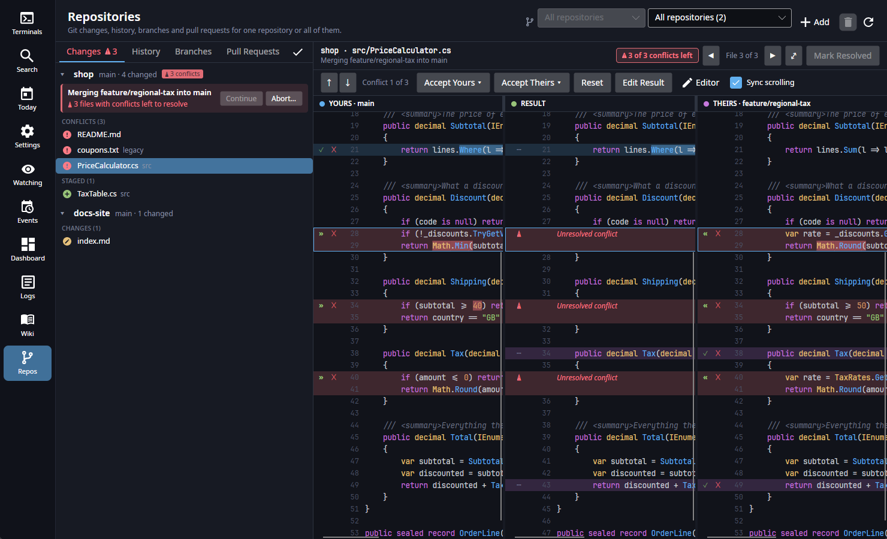

Selecting a conflicted file opens the merge tool: **Yours**, **Result** and **Theirs** side by side, with line
numbers and syntax highlighting, built from the three versions git keeps of the file (not from the conflict markers).
Inside a changed line, the words that actually differ are marked more strongly than the rest of the line.

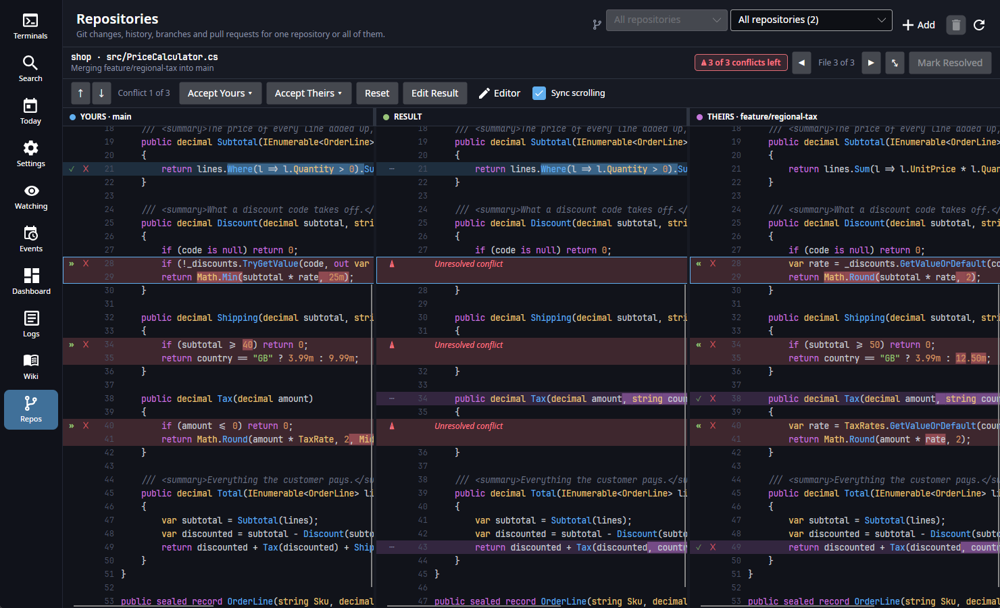

- Changes only one side made are already in the result; `✕` beside one leaves it out, `»` / `«` puts it back.
- Conflicts start open. `»` takes yours, `«` takes theirs, and taking the second side as well appends it. The mark
  in the result's margin opens a menu: both in either order, neither, or **Edit the Result Here** to type the lines.
- **Accept Yours** / **Accept Theirs** settle the conflicts still open, every conflict, or take that side's whole file.
- `↑` `↓` walk the conflicts, `◀` `▶` the conflicted files; `⤢` gives the tool the whole width.
- **Sync scrolling** keeps the three panes together; switch it off to scroll one on its own.
- **Mark Resolved** lights up once nothing is open. It writes the result, stages the file and moves to the next one.

| | |
|---|---|
| 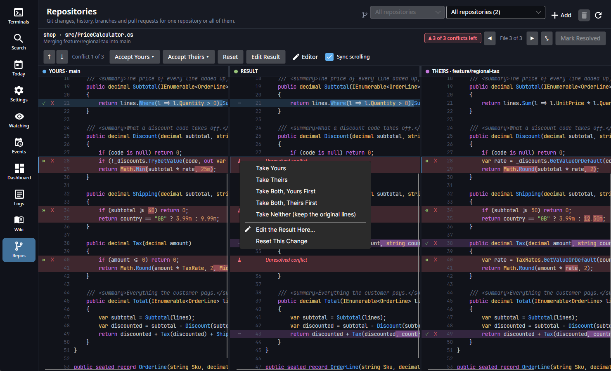 | 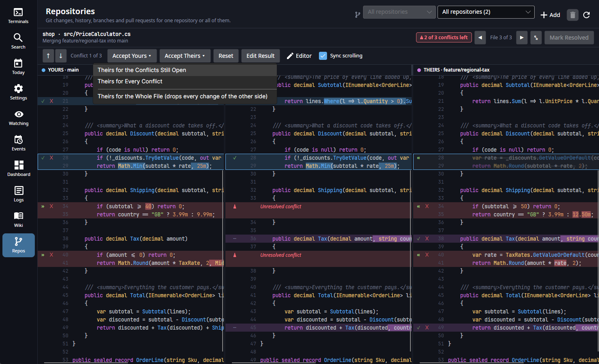 |
| 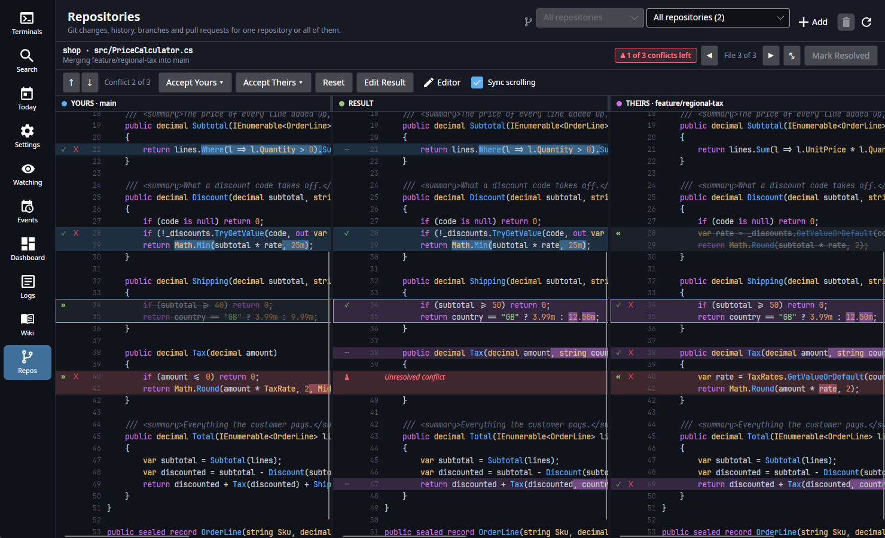 | 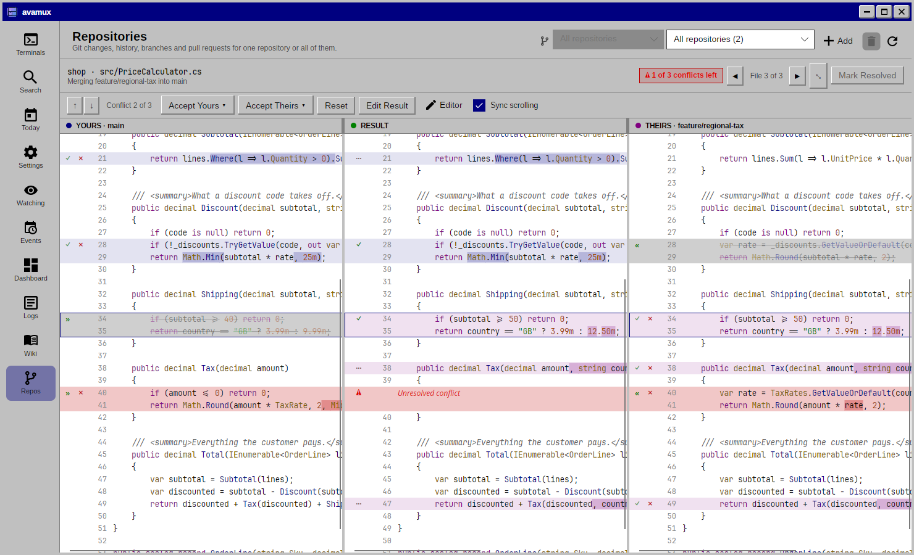 |

### Editing the result

The result can also be edited as plain text, in two ways. Either way, conflicts still open appear between git's
`<<<<<<<` / `=======` / `>>>>>>>` markers, and what you type comes back into the merge without losing anything:
every change you did not touch keeps its decision, a conflict is settled once its markers are gone, and lines you
edited elsewhere become hand-made changes of their own (shown in the warning colour, undone from the margin menu).

- **Edit Result** turns the Result pane into an editor. **Done Editing** or Esc goes back to the aligned view.
- **Editor** opens the result in `repositories.editor` (vim, neovim…) in a terminal tab and links the two: each save
  there updates the Result pane, and each decision made in the tool is written to the file.

| | |
|---|---|
| 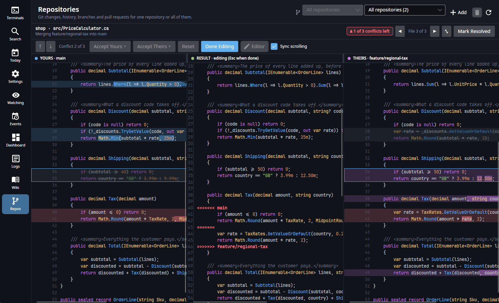 | 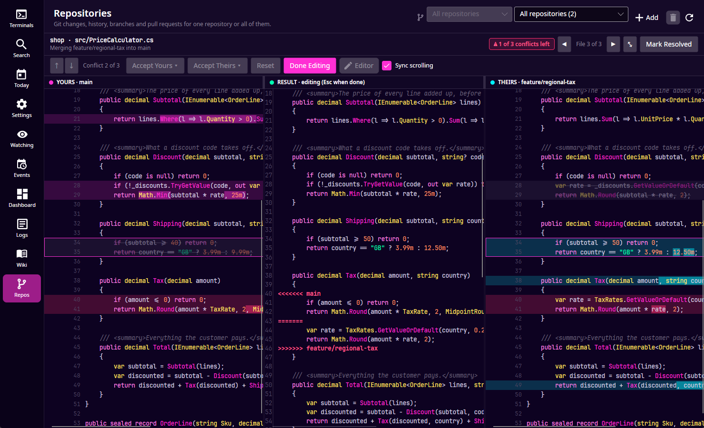 |
| 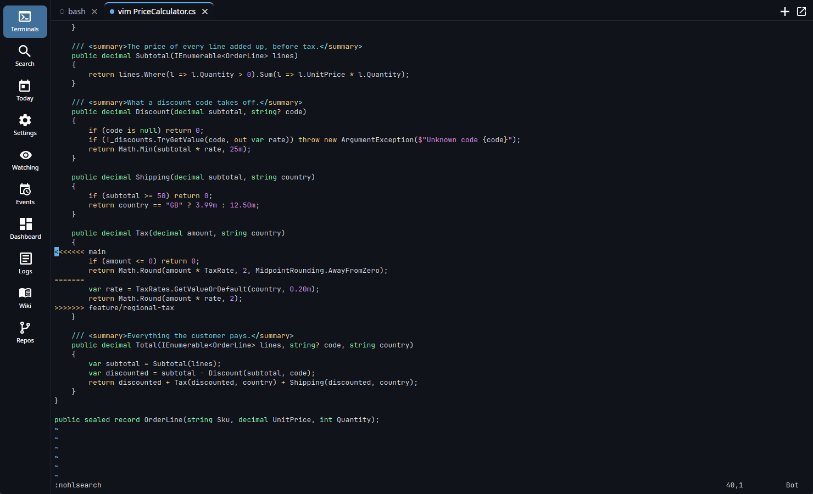 | 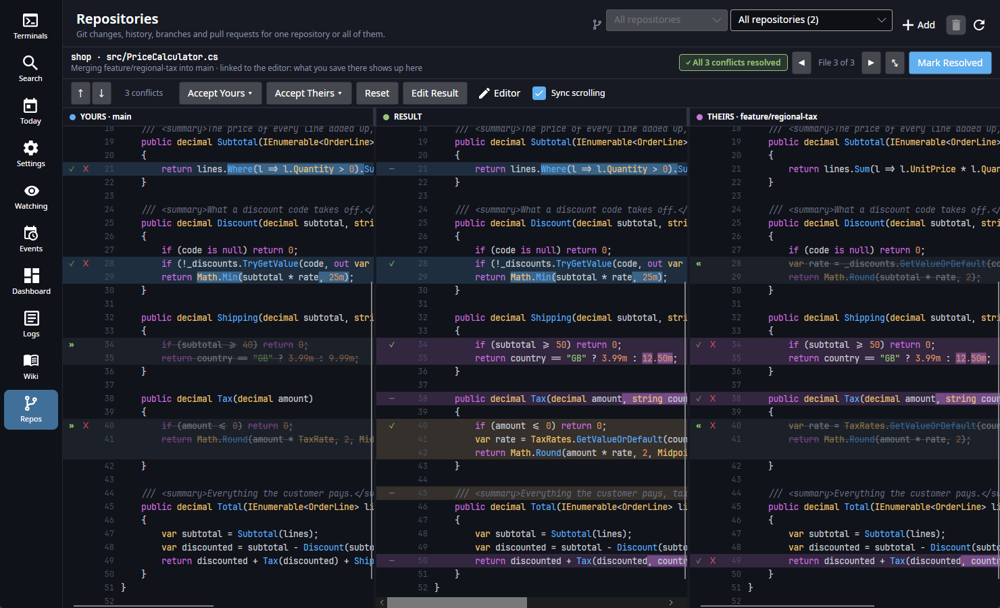 |

### Finishing

A file one side deleted, or one that is not text, offers a choice of side instead. When no conflict is left the
banner turns green and **Continue** commits the merge (or carries on with the rebase); **Abort** puts everything back.
During a rebase git's sides are swapped, and the pane titles say which is which.

| | |
|---|---|
| 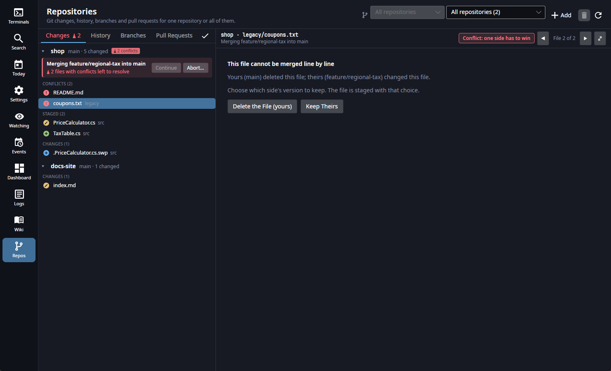 | 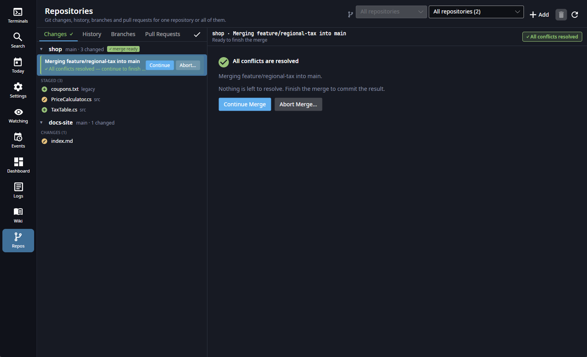 |

The colours follow the theme: yours is the accent, theirs the theme colour furthest from it.

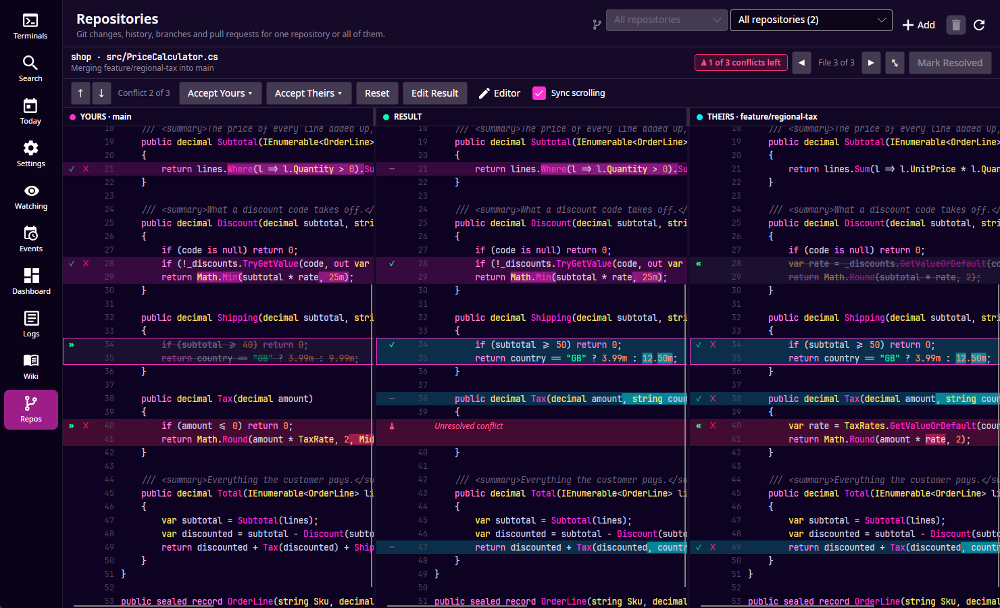

## The wiki in git

The wiki folder can be a git repository of its own. The **Git** button in the wiki's toolbar shows the branch and
how many files changed since the last commit, and opens a menu:

- **Start Keeping History with Git** runs `git init` in the wiki folder (only offered until it is a repository).
- **Commit All Changes…** stages everything and opens the commit dialog, the same one the Repositories page uses.
- **Review Changes…**, **History…** and **Branches…** open the wiki in the Repositories screen, in a window of its
  own and showing the wiki alone. Everything that screen does works here: stage files, hunks or lines; view a
  commit file by file; revert, cherry-pick, reset (soft, mixed, hard), check out a commit, tag; create, merge,
  delete and switch branches; resolve conflicts in the merge tool.
- **Switch Branch** lists the branches and makes new ones.
- **History of *page*…** lists the commits that changed the open page and shows the page as each left it.
  **Restore This Version** puts the page back that way, as a change to commit, so nothing is lost.
- **Discard Changes to *page*…** puts the open page back the way the last commit has it.

Unsaved edits are saved before git looks, and when git changes files (a branch switch, a revert, a restore) the
tree, the editor and the preview follow. From the command line the wiki is the repository called `wiki`:
`avamux repo status wiki`, `avamux repo log wiki`, `avamux repo switch wiki drafts --create`,
`avamux repo commit wiki "Notes from today"`, and `avamux repo select wiki` opens its window.

## Git Activity

Git Activity reads every repository of the sources set under **Git Activity Settings** (kept in `git-activity.json` in
the data folder, apart from the other settings; **Edit File** opens it) and shows, for any range of days (the last two
months to begin with):

- **Heatmap**: rows by one thing and columns by another: repositories × days, contributors × repositories, frameworks
  × weeks, weekday × hour, and so on. Click a row or a cell to look at just that; right-click a row for more.
- **Leaderboards**: top contributors, repositories, branches (mainline ones marked), languages, frameworks and file
  types, each with its weekly line, whether it is picking up or slowing down, and how much of it had AI help.
- **Rhythm**: when the work is done (in each author's own time zone), per person, and week-by-week momentum per repository.
- **AI**: AI help week by week, by tool (Claude Code, GitHub Copilot, Cursor, Codex, Aider, Devin, Gemini, Amazon Q…),
  by model, and who uses it. AI is recognised from `Co-authored-by` trailers, "Generated with" lines and agent
  accounts, and the commit is credited to the person, not the tool: a commit authored by the Copilot agent counts
  for the human it worked with. Extra rules go in `aiRules`.
- **Frameworks & Languages**: over 500 file extensions and names (C#, VB.NET, F#, Razor, XAML, MSBuild, web, data, SQL, scripts,
  infrastructure…) and over 150 frameworks (Next.js, React, React Native, Angular, Vue, ASP.NET Core, Blazor,
  MediatR, EF Core, MAUI, WPF, Spring, Django, Terraform…), recognised from each project's manifests *as they were
  when each commit was made*: a repository that moved from Angular to React shows Angular for the work before the
  move and React after it, including moves that arrive through a merge. A file counts toward the frameworks of the
  projects it is in; test frameworks count only for test files.
- **Commits**: the commits behind the figures. Double-click one, or right-click any repository, branch or commit, to
  open it on the Repositories page (a repository that is not on this computer is cloned first) or in the browser.

Filters: a range of days (presets such as Last 30 days, This quarter, Last year, All time; or any From and To,
where an empty From is the beginning and an empty To is the present), contributors and repositories with a commit
in the last N days of the range (to hide people who left and projects gone quiet; defaults under Settings), all /
non-mainline / mainline branches (mainline names such as `main`, `develop`, `release/**`
are a list in the settings), with or without AI, bots, merges, words, and which contributors count
(**Contributors…**, or right-click one). Measure commits, lines changed, added or removed, files, or contributors.

Sources: `github` (an organisation or user; token from `GITHUB_TOKEN` / `GH_TOKEN` or `gh auth login`),
`azure-devops` (an organisation, or one project; `az login`, or a PAT in `AZURE_DEVOPS_EXT_PAT`), `local` (a folder
of clones), `git` (clone URLs, using git's own credentials) and `repositories` (the Repositories page). Remote
repositories are kept as shallow bare mirrors holding only what is read (`git-activity/mirrors`): the period, or from
`readFrom` (a date, or `all` for the whole history). Choosing an earlier start on the page reads further back by
itself. Later reads only read the commits that are new since the last one. A repository whose
branch tips have not moved is not fetched or read again, and one GitHub says was not pushed to in the period is not
fetched at all. For very large organisations, `"detail": "files"` downloads names only (no line counts).

CLI: `avamux activity sources|add|remove|repos|scan [--wait]|status|stop|summary|top <by>`, e.g.
`avamux activity top contributor --no-mainline --ai with`, or
`avamux activity top framework --from 2024-01-01 --to 2024-12-31 --repos-active 90`.

## C# Interactive

A C# prompt inside the running app, for trying things against the live avamux. On the left is a terminal: type C#
and press Enter. On the right is a screen of live controls that the code (and a XAML document) builds, and that
you can click.

```csharp
> new [] { "a", "b", "c" }.ToList().Select(x => x)
IEnumerable<string> { "a", "b", "c" }
> var b = Add(new Button { Content = "Hello" });
> b.Click += (_, _) => Print("clicked");                 // clicking the button writes to the terminal
> avamux.Terminals.Sessions.Select(t => t.Title)
> await avamux.Command("terminal new", new { name = "build" })
> await Task.Delay(1000); DateTime.Now                   // await works anywhere
```

- An expression without a semicolon shows its value, laid out like a REPL does (lists, dictionaries, tuples,
  records and anonymous objects spelled out, JSON indented). Variables, `using`s, methods and classes stay for
  later lines. `Vars()` lists the variables, `Help()` everything else.
- **Several lines**: Enter continues a statement that is not finished (an open brace, a missing semicolon),
  Shift+Enter always starts a new line, Ctrl+Enter always runs. Pasted code keeps its lines. Up and Down walk the
  history; Esc empties the prompt; Ctrl+L empties the terminal.
- **Async**: `await` anything. The window stays responsive while awaited code waits. A task left un-awaited is
  shown as running and its result is printed when it finishes. **Stop** gives the prompt back and cancels the
  `Cancel` token (`await Task.Delay(60000, Cancel)`).
- **avamux**: the `avamux` variable is the running app: `avamux.Terminals`, `.Wiki`, `.Events`, `.Watches`,
  `.Repos`, `.Settings`, `.Host`, `.Services` (everything), `avamux.Notify(title, text)`, `avamux.Navigate(page)`,
  and `await avamux.Command(name, new { option = value })` for any command the CLI has.
- **The screen**: `Add(control)` puts a control on it and returns it, `Xaml("<Button Content='Hi'/>")` builds one
  from XAML text, `Find<Button>("name")` gets one by its `Name`, `Screen` is the panel itself. The **XAML** tab
  holds a document the top of the screen is built from (Apply, or Ctrl+Enter); in it,
  `i:On.Click='Print("clicked")'` runs C# from the session when the control is clicked.
- `Print(value)` and `Console.WriteLine` write to the terminal, also from event handlers and other threads. An
  exception thrown later by a handler is shown there too.

The page starts with a few working examples (shown in the terminal as the code that made them): a button that
prints a message, one that raises an avamux notification, one with an async handler, a slider bound to a label,
and the same from XAML. **Reset** forgets every variable and builds them again.

Code runs on the UI thread, so it can touch controls, and so a loop that never awaits freezes the window until it
ends: await, or use `Task.Run`, for anything long. It runs with everything avamux can do; it is your own machine
and your own code, like a plugin.

## Browser panes

Each terminal tab can have a browser beside it: the globe button at the end of the tab strip (or Ctrl+Shift+L, in
the terminal or in the page) opens one, and hides or shows it again. Drag the line between the terminal and the browser to
make either wider; avamux remembers the width. A split tab has one browser, shared by its panes. It is a real web view (WebKitGTK on Linux, WKWebView on macOS) with tabs of its
own, an address bar (text that is not an address is searched for, `browser.searchUrl`), back, forward, reload, zoom
(Ctrl+plus/minus/0), the page's own alert/confirm/prompt dialogs shown above it, and the Web Inspector (F12, or the bug
button, which gets a red dot when the page has thrown errors). The inspector docks inside the pane when the pane is at
least 750 px wide, and opens in a window of its own otherwise. A pane can move into a window of its own and back
(the ⋮ menu or `avamux browser move window|dock`); closing that window puts it back beside its tab. Closing a tab
closes the panes docked beside it. Links that a page opens in a new window become new tabs in the same dock.

**Keep alive.** The pin button keeps a pane's page running while you look at another tab or page (Watching, say):
it stays loaded at its size, keeps its timers and animations going, and always reports itself visible and focused
(`document.visibilityState`, `blur` and `visibilitychange` included), so a running app or game is where you left it.
`browser.keepAliveByDefault` turns it on for new panes. (On Linux, WebKitGTK keeps panes running when they are out of
view anyway; there keep alive also pins what the page is told. WKWebView on macOS slows hidden pages down; keep alive is
meant to prevent that there, but has not been tried on a Mac yet.)

**Design mode.** The hand button (Ctrl+Shift+C in the page) lets you click an element: its selector, ref, text, box,
styles and HTML go to the clipboard, ready to paste to an agent.

**For agents.** Every terminal gets `AVAMUX_TERMINAL_ID`, and `avamux browser …` run in a tab acts on the pane beside
that tab, so an agent drives its own browser while you watch (and can open the inspector on the same page). The
commands follow [agent-browser](https://github.com/vercel-labs/agent-browser) and cmux:

```sh
avamux browser open localhost:3000            # beside this tab; waits for the load; prints the pane id (b1)
avamux browser snapshot -i                    # what can be clicked or typed into, with refs: - button "Save" [ref=e7]
avamux browser fill e3 "ada@example.com"
avamux browser click e7 --snapshot-after      # act, then see the page again
avamux browser wait --text "Saved"            # or --selector, --url-contains, --load-state networkidle, --function
avamux browser find role button --name "Delete" click
avamux browser errors && avamux browser network --failed
avamux browser dialog accept                  # the confirm() the click opened
avamux browser eval 'document.title'
avamux browser screenshot --full --out page.png
avamux browser state save login.json          # cookies and storage, to load into another pane
```

Also `goto`, `back`, `forward`, `reload [--hard]`, `get text|html|value|attr|count|box|styles`, `is
visible|enabled|checked`, `hover`, `focus`, `type`, `press "Control+a Backspace"`, `keydown`/`keyup`, `select`,
`check`/`uncheck`, `scroll`, `drag`, `upload`, `highlight`, `console`, `cookies`, `storage`, `tab list|new|switch|close`,
`frame`, `pdf`, `zoom`, `viewport 390 844`, `devtools`, `keep-alive`, `design-mode`, `show`, `close` and `list`; each
takes `--surface b2` to name another pane. `avamux browser /?` lists them all. Errors start with a code an agent can
act on: `not_found` (a stale ref: snapshot again), `invalid_state`, `timeout`, `js_error`, `not_supported`.

`frame` only reaches iframes of the same site. For a cross-origin iframe, `addinitscript` (as in cmux) adds a script
that runs at the start of every page from the next load on, before the page's own scripts, in every frame, cross-origin
ones included (`--main-frame` for the main page only; on WebKitGTK and WKWebView). The script can `postMessage` what it finds to the
main page, and `avamux browser messages` lists what the main page received (origin, which frame, data).
`initscripts` lists them, `initscripts remove i1` and `initscripts clear` take them away.

`avamux browser skill --install` puts an `avamux-browser` skill for Claude Code (and Codex, when installed) in
`~/.claude/skills`, so agents know all this without being told. With `browser.setBrowserVariable`, new terminals
also get `BROWSER` pointing at avamux, so a program that opens a web page (a CLI login, a dev server's `--open`)
opens it in the tab's pane. A Ctrl+click on a link in a terminal opens it there too (`browser.terminalLinksInPane`
swaps plain click and Ctrl+click; `browser.externalSites` lists sites that always go to the system browser).
`browser.agentControl` switches command-line control off.

What the system web view cannot do (as in cmux): intercept or mock network requests, emulate offline or a
location, record traces, or report response bodies and HttpOnly cookies. An exact viewport, docking the inspector and
the page's dialogs as a bar above it need WebKitGTK (Linux). Screenshots work with WebKitGTK and with WKWebView on macOS
(not yet tried there; `--full` on macOS captures at most 16,384 points of the page, and content the GPU draws, such
as WebGL and video, can come out blank). On macOS WKWebView gets the agent and the init scripts at the start of every
page too, so the console is recorded from the very start and cross-origin frames are reached. Panes are not restored when avamux restarts, as terminals are not.

## Caffeine

The Caffeine page keeps the computer from sleeping (and, with `caffeine.keepDisplayOn`, the screen from blanking):
- **until you turn it off**;
- **for a while**: 15 minutes to 8 hours, a length (`45m`, `1h30m`) or a clock time (`17:30`); it turns itself off
  and says so when the time is up;
- **while terminals are busy**: whenever a terminal is running a command or an AI agent is working, and for
  `caffeine.graceMinutes` (5) after the last one goes quiet. A terminal at its prompt, or an agent waiting for
  input, does not count.

A dot on the navigation button shows when it is on (green while it is holding the computer awake). From the CLI:
`avamux caffeine on [--for 2h | --until 17:30 | --terminals]`, `avamux caffeine off`, `avamux caffeine status`.
It uses `systemd-inhibit` on Linux, `caffeinate` on macOS and the power API on Windows, and ends when avamux closes.

## The boss screen

Ctrl+Shift+B (`ui.bossKey`, empty to switch it off) swaps the window for something that looks like work, in the
spirit of the boss keys of old DOS games: a budget spreadsheet, or with `ui.bossScreen` set to `build`, a build log
that scrolls forever. The window title changes to match, sounds stay quiet, and avamux's other windows are minimized
(`ui.bossHidesWindows`). The same key or Esc brings everything back; terminals keep running underneath. It works
while a terminal has the keyboard too, but not while typing in the dashboard or the wiki preview. `avamux app boss`
toggles it from the command line.

## Pull requests are watches

The Repositories page's Pull Requests tab shows the result of a watch of kind `repo-pr` for that repository, so the
list refreshes on the watch's interval, notifies on change and can be managed on the Watching page. By default it
runs `gh pr list`; set `repositories.pullRequestCommand` (or the watch's own `command`) to any command that prints
a JSON array of pull requests (`number`, `title`, `state`, `isDraft`, `author`, `url`, `headRefName`,
`baseRefName`, `updatedAt`, and optionally `mine` and `active`) or the usual watch result object.

## Configuration

Settings are JSON, merged in this order (later wins):

1. built-in defaults
2. `~/avamux.json`
3. `~/avamux.local.json`
4. `./avamux.json` (the folder avamux was started in)
5. `./avamux.local.json`

A file only needs the keys it changes:

```json
{ "terminal": { "scrollback": 10000, "fontSize": 14 }, "watching": { "defaultIntervalMinutes": 5 } }
```

`avamux settings list` shows every key, its value and its source. `avamux app paths` shows where data lives
(`~/.local/share/avamux` on Linux, `~/Library/Application Support/avamux` on macOS).

## CLI

```sh
avamux /?                      # also -?, --?, -h, --help, /help, help; works per group and per command
avamux terminal new --name build -- dotnet watch
avamux terminal send build "^C" --keys
avamux settings set terminal.scrollback 20000 --scope home-local
avamux event timer 25m Focus --run "notify-send done"
avamux event add Standup --start "tomorrow 9:30" --duration 15m --repeat weekly --days mon,tue,fri
avamux event skip Standup 2026-12-25 2026-12-28   # no start, end, notification or script on those days
avamux event unskip Standup 2026-12-25
avamux event running            # events in progress and event scripts still running
avamux watch add "My PRs" --kind github-pr --set repo=owner/name --set author=me
avamux repo add . && avamux repo status
avamux repo prs avamux --mine
avamux search "release notes" --source wiki --source events
avamux wiki today
avamux theme set classic90s
avamux theme show synthwave-kat --file mine.yaml && avamux theme import mine.yaml --use
avamux caffeine on --for 1h30m
avamux browser open localhost:3000 && avamux browser snapshot -i   # see Browser panes
```

Add `--json` to any command for machine-readable output. The same commands are available to dashboard
JavaScript: `await avamux.command('terminal new', { name: 'build' })`.

## Custom pages

Settings → Custom pages (or `avamux page …`) adds entries of your own to the navigation, each with a name and an
icon (one of the built-in icons by name, or SVG path data for a 24x24 box). Adding, changing, reordering and
switching them takes effect at once; nothing needs a restart. They are stored in `nav.json` in the data folder.

- **Terminal**: one command in a terminal of its own that fills the page: `btm`, `lazygit`, `lazydocker`,
  `ssh -p 2222 -L 8080:localhost:80 me@host`. The line is run through your login shell. When the program ends the
  page offers to start it again (and does so by itself the next time you go to the page).

  ```sh
  avamux page add Monitor --kind terminal --command "btm" --icon pulse
  avamux page add Git --kind terminal --command "lazygit" --cwd ~/code/project --icon source-branch
  ```

- **Web**: a web page (Teams, Outlook, Gmail, a Grafana board) with back, forward, reload and the developer tools.
  The page gets a deliberately small `window.avamux`: `needsInput(message)`, `clearNeedsInput()`,
  `notify(title, message)` and `setBadge(text)`. It can draw attention to itself and nothing else: it cannot run
  commands or read anything from avamux. A page's **script** (JavaScript run after each load) is where to use it
  for sites that are not yours:

  ```sh
  avamux page add Mail --kind web --url https://mail.example.com --icon email \
    --script "setInterval(() => avamux.setBadge((document.title.match(/\((\d+)\)/) || [])[1]), 3000)"
  ```

- **Plugin**: a page built by a .NET DLL. Implement `Avamux.Plugins.IPagePlugin` (project
  `src/Avamux.Plugin.Abstractions`): `CreateView(IAvamuxHost host)` returns an Avalonia control. A plugin is fully
  trusted: `IAvamuxHost` runs any avamux command (`CommandAsync`, `RunAsync`), reads and writes settings, navigates,
  notifies, and hands out avamux's own services. `samples/page-plugin/` is a page of sample controls, several of
  them calling avamux. After rebuilding a plugin, reload it with the page's reload button or `avamux page reload`.

  ```sh
  dotnet build samples/page-plugin
  avamux page add Sample --kind plugin --assembly "$PWD/samples/page-plugin/bin/Debug/net10.0/SamplePagePlugin.dll"
  ```

A page that wants you (`avamux.needsInput`, `host.RequestAttention`, `avamux page attention <page> <message>`)
gets a dot on its navigation entry and a notification, unless it is the page you are looking at; the dot goes
when you open the page. `avamux page badge <page> <text>` shows up to four characters on the entry.

## Watches are pluggable

Built-in kinds: `github-pr`, `ado-pr`, `ado-pbi`, `ado-pipeline`, `repo-pr`, `command`, `plugin` (`avamux watch kinds`).
The GitHub and Azure DevOps kinds follow the public REST APIs but have not been run against live accounts yet.

- **Script** (`command`): run anything that prints this JSON; see `samples/watch-scripts/`.

  ```json
  {"status": "ok|info|warn|error", "summary": "…", "link": "https://…",
   "items": [{"title": "…", "status": "…", "detail": "…", "link": "https://…"}]}
  ```

  Plain text also works: the first line is the summary and the exit code the status (0 ok, 1 warn, other error).
  Watch settings arrive as `AVAMUX_WATCH_<KEY>` environment variables.

- **.NET plugin**: implement `Avamux.Plugins.IWatchProvider` (project `src/Avamux.Plugin.Abstractions`) and drop
  the DLL into the plugins folder, or point a `plugin` watch at it with `--set assembly=/path/to.dll`.
  `samples/watch-plugin/` is a complete example.
