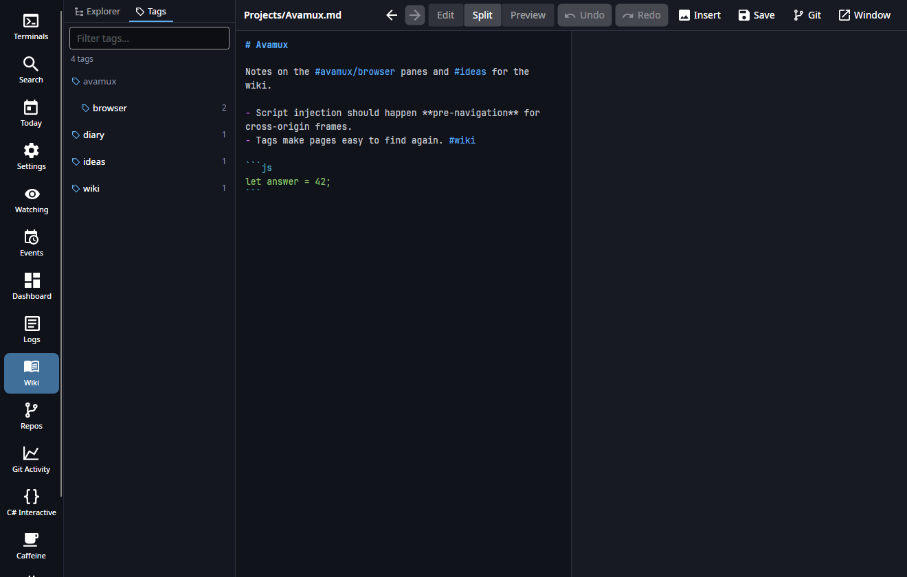
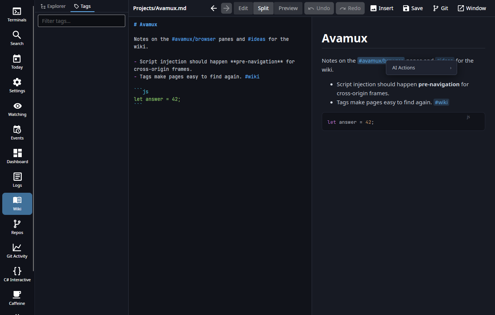
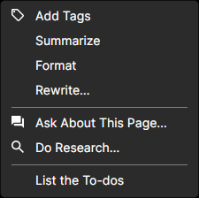
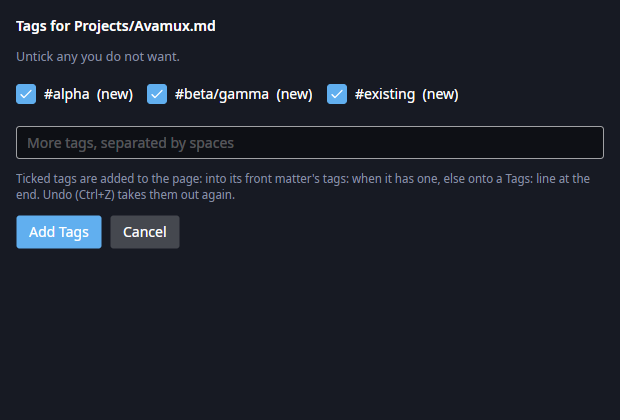

# AI Actions

| | |
|---|---|
|  |  |
|  |  |

AI Actions is a [plugin](plugins.md) that comes with avamux; switch it off under Settings → Plugins. It adds an
**AI Actions** submenu to the right-click menus of the wiki's editor, preview and folder tree, and of terminals.

Actions that only produce text run without tools and change nothing until you say so. Their provider, model and
effort are `ai.actionsProvider`, `ai.actionsModel` and `ai.actionsEffort`: Claude Code, Haiku and low, to begin
with, so they are quick and cheap. Actions in progress show on the [AI Workloads](ai-workloads.md#tasks) page's Tasks
tab, where they can be stopped.

## The actions

| Action | Where | What it does |
|---|---|---|
| Add Tags | Wiki | Suggests 3 to 7 #tags for the page, preferring tags the wiki already uses. Untick any you do not want and add your own; they go into the page's front matter `tags:` if it has one, else onto a `Tags:` line at the end. One undo step. |
| Summarize | Wiki | The selection, or the page, summarised in a window as it is written: Copy, Insert Below, Speak, or **Open in AI Chat** to carry the conversation on. |
| Format | Wiki | Tidies the markdown without changing what it says. Shows the change line by line first; Accept makes it as one undo step. |
| Rewrite… | Wiki | Rewrites the selection or page as you ask (shorter, friendlier, as a list…), shown and accepted the same way. |
| Ask About This Page… / Folder… | Wiki | Opens [AI Chat](ai-chat.md) on a conversation set up to answer from the wiki: it searches the pages, reads them, and names the pages it used. |
| Do Research… | Wiki | The same, not tied to one page: find answers across the whole wiki and say where they came from. Also offered in terminals when nothing is selected. |
| Send Selection to a Terminal… | Wiki | Types the selected text into a terminal. |
| Explain Selection | Terminal | What the selected output means, in a window. |
| Ask in AI Chat… | Terminal | Opens AI Chat with the selected output in the message box, for you to ask about. |
| Copy Selection into a Wiki Page… | Terminal | Adds the selected text to the end of a wiki page. |

The wiki conversations can be asked anything. When you ask, they can also use the `avamux` command line: add what they
found to a page, or work with terminals.

## Your own actions

Set up under Settings → Plugins → AI Actions. Each has:

- a **name**;
- the **menus** it shows in: wiki editor, wiki preview, wiki folder tree, terminal;
- a **prompt**, with placeholders:

  | Placeholder | Becomes |
  |---|---|
  | `{{selection}}` | The selected text. |
  | `{{page}}` | The whole page, unsaved edits included. |
  | `{{pagePath}}` | The page's path in the wiki. |
  | `{{tags}}` | The page's tags. |
  | `{{allTags}}` | Every tag in the wiki. |
  | `{{input}}` | Something you type when the action runs (it asks first). |

- what happens to the **reply**:

  | Result | |
  |---|---|
  | `window` | Shown in a window, as Summarize does. |
  | `replace` | Replaces the selection, after showing the change. |
  | `below` | Inserted under the selection. |
  | `chat` | Opens a new chat in AI Chat. |
  | `page` | A new wiki page. |

- optionally its own **provider**, **model** and **effort**, and whether it may use **tools** (read other pages, run
  commands).

They are kept in `plugin-data/ai-actions/actions.json` in the data folder. For example, an action that turns a
selection into a checklist:

```json
[
  {
    "name": "Make a Checklist",
    "menus": ["wiki.editor", "wiki.preview"],
    "prompt": "Turn this into a markdown checklist of concrete tasks. Reply with the list only.\n\n{{selection}}",
    "result": "replace"
  }
]
```

## Tags from the command line

`avamux wiki tags add <page> <tags…>` adds tags the same way Add Tags does: into the front matter's `tags:` when the
page has one, else onto a `Tags:` line at the end.

## Settings

| Setting | Default | What it does |
|---|---|---|
| `ai.actionsProvider` | `claude-code` | The provider actions use unless an action names another. |
| `ai.actionsModel` | `haiku` | The model, with the default provider. Empty: the provider's own. |
| `ai.actionsEffort` | `low` | The effort, with the default provider. Empty: the provider's own. |
| `ai.chatFolder` | empty (the wiki) | The working folder for the conversations actions open. |
