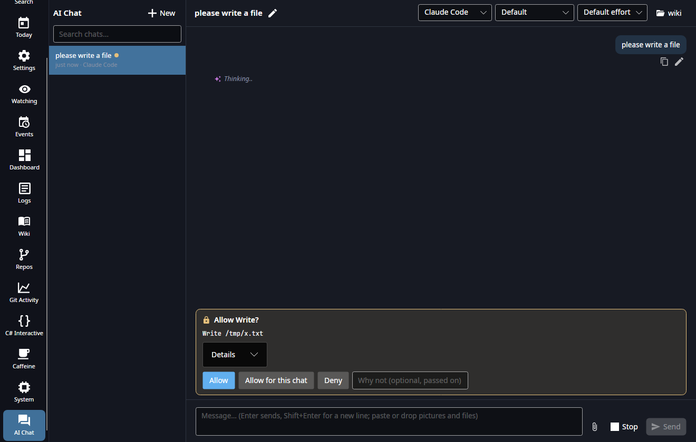

# AI Chat



AI Chat talks to coding agents that bring their own tools. avamux runs their command lines, signed in as you already
are, and shows what they do: thinking, tool calls, permission requests and questions, pictures, and how full the
context is.

## Providers

The providers are under **Settings → AI Chat**, kept in `ai-providers.json` in the data folder. There are three
kinds to begin with, and plugins can add more (`IAiProvider`; see [Plugins](plugins.md)).

### Claude Code

Runs as `claude -p` with stream-json both ways, one process per chat.

Nothing is restricted unless you set it: it asks before editing or running anything, as it does in a terminal. Its
permission requests and its questions (AskUserQuestion) show as cards above the message box: **Allow**, **Allow for
this chat**, or **Deny** with a reason. A question's options are buttons, with room to type your own answer.

Each Claude Code provider can be given:

| Option | Claude Code flag |
|---|---|
| A permission mode (`default`, `acceptEdits`, `plan`…) | `--permission-mode` |
| Tools it may use without asking | `--allowedTools` |
| Tools it may never use | `--disallowedTools` |
| Extra folders it may use | `--add-dir` |
| Full access: no permission prompts at all | `--dangerously-skip-permissions` |

### pi

Runs in RPC mode with any model pi knows (`avamux ai models <provider>` lists them). avamux loads a small pi extension
of its own that gives the model an `ask_user` tool and, when set to, asks before chosen tools run
(`--confirm-tools`, `*` for all).

### Other command lines

Any other agent with a one-shot command line, from a template: `{prompt}` is the message, and `[--model {model}]` is
dropped when no model is set. Each message runs the template once, with the conversation so far in the prompt, and
reads the reply from standard output, as plain text or JSON lines. Presets:

| Preset | Template | Output |
|---|---|---|
| Codex | `codex exec --json --skip-git-repo-check [--model {model}] {prompt}` | jsonl |
| Gemini CLI | `gemini -p {prompt} --output-format stream-json [--model {model}]` | jsonl |
| opencode | `opencode run [--model {model}] {prompt}` | text |
| aider | `aider --message {prompt} --no-stream --yes-always [--model {model}]` | text |

These are best effort and not tested by avamux.

## Chats

- **Per chat**: provider, model (from a list, or type any name), effort or thinking level, and the folder the agent
  works in: the wiki by default, or `ai.chatFolder`. New chats start with `ai.chatProvider` (empty: the first one).
- **Context**: the ring in the header shows how full the context is.
- **Thinking** is shown while it happens and folded away after ("Thought for 12 s"); `ai.expandThinking` leaves it
  open.
- **Tool calls** are one line each, which opens to show the input and output.
- **Replies** are markdown with selectable text, code blocks with a copy button, tables, and pictures (from markdown,
  or files the reply names by path) that open full size and can be saved, copied or shown in their folder.
- **Attachments**: paste or drop pictures and files, or use the paperclip. Pictures go to models that take them as
  pictures; other files are saved with the chat and named by path for the agent to read.
- **Keeping**: chats are kept in `ai/chats/` in the data folder and carry on after a restart.

Each message can be copied, inserted into the wiki, or [spoken](#speaking-replies-kokoro).

## Editing and branching

- **Edit one of your messages** to send it again. The old exchange stays, and ‹ 1/2 › switches between the versions.
  Claude Code and pi branch their own conversation at that point, so each version continues from what the agent
  really saw.
- **Retry** writes a reply again, the same way.
- **Edit a reply** to change its saved text (nothing is sent; it is marked "edited"). This is only offered where the
  model will see the change: for command-line providers, which are given the whole conversation every turn. Claude
  Code and pi keep their own copy of the conversation, so an edited reply would only change avamux's copy; their
  replies cannot be edited.

## Keys

| Keys | What they do |
|---|---|
| Enter | Send |
| Shift+Enter | New line |
| Ctrl+V, Shift+Insert | Paste; copied pictures and files become attachments |
| Esc | Stop the reply |
| Ctrl+N | New chat |
| Ctrl+Enter / Esc | While editing a message or reply: send or save it / cancel |

## Speaking replies (Kokoro)

The speaker button on a reply reads it aloud with [Kokoro](https://github.com/thewh1teagle/kokoro-onnx), sentence by
sentence. Code blocks are skipped, and so is anything after a line that is only `---`.

It is **off by default**. The first time something is to be spoken, avamux asks whether to switch it on, or says what
is missing if it is not set up. To set it up, point avamux at a Python with `kokoro_onnx` installed and at the model
and voices files, for example in `~/avamux.local.json`:

```json
{ "ai": { "tts": {
  "python": "/path/to/venv/bin/python",
  "model": "/path/to/kokoro-v1.0.onnx",
  "voices": "/path/to/voices-v1.0.bin"
} } }
```

A small helper keeps the model loaded and unloads it after `ai.tts.idleMinutes` without speaking. Switching
`ai.tts.enabled` off, or quitting, ends it and anything playing.

| Setting | Default | What it does |
|---|---|---|
| `ai.tts.enabled` | false | Speech at all. Nothing starts until it is on. |
| `ai.tts.python` | empty | The Python that has `kokoro_onnx` (and onnxruntime). |
| `ai.tts.model` | empty | `kokoro-v1.0.int8.onnx` or `kokoro-v1.0.onnx`. |
| `ai.tts.voices` | empty | `voices-v1.0.bin`. |
| `ai.tts.voice` | `af_nova` | The voice. |
| `ai.tts.speed` | 1.05 | |
| `ai.tts.volume` | 0.85 | 0 to 1. |
| `ai.tts.autoSpeak` | false | Read every reply as it is written. |
| `ai.tts.idleMinutes` | 10 | Unload the model after this long without speaking; 0 keeps it loaded. |

```sh
avamux ai tts status                   # on or off, set up or not, and the voices
avamux ai tts on && avamux ai tts say "Build finished"
avamux ai tts stop && avamux ai tts off
```

Speech is also open to plugins (`context.SpeakAsync`), and AI Actions' Summarize window has a Speak button.

## From the command line

```sh
avamux ai providers                         # and: ai kinds, ai models <provider>
avamux ai provider add Codex --kind command --command codex \
  --template "exec --json --skip-git-repo-check [--model {model}] {prompt}" --output jsonl
avamux ai provider set claude-code --allowed-tools "Read,Grep,Glob"   # limits are off unless set
avamux ai provider set claude-code --permission-mode acceptEdits --folders ~/code/shared
avamux ai run "Summarise the README in one line" --provider claude-code --model haiku   # no tools unless --tools
avamux ai chat new "When did we decide on pre-navigation injection?"   # opens it in AI Chat (--no-open not to)
avamux ai chat list && avamux ai chat send <chat> "And why?"
avamux ai chat show <chat> && avamux ai chat stop <chat>
```

`ai run` and `ai chat new` take `--provider`, `--model`, `--effort` and `--folder`.

## Settings

| Setting | Default | What it does |
|---|---|---|
| `ai.chat` | true | Show the AI Chat page. |
| `ai.chatProvider` | empty | The provider new chats start with. Empty: the first one. |
| `ai.chatFolder` | empty | The agent's working folder for chats and actions. Empty: the wiki. |
| `ai.expandThinking` | false | Show thinking open rather than folded. |

Chats in progress also show on the [AI Workloads](ai-workloads.md) page's Tasks tab, where they can be stopped.
