# Resolving conflicts

When a merge, rebase, cherry-pick or revert stops for conflicts, the Changes tab of the
[Repositories](repositories.md) page says so: the tab and the repository's header carry a red count, a banner names
what is being merged into what, and the conflicted files are listed first under **Conflicts**. This works the same with
one repository selected or all of them, and for the [wiki's own repository](wiki.md#the-wiki-in-git).

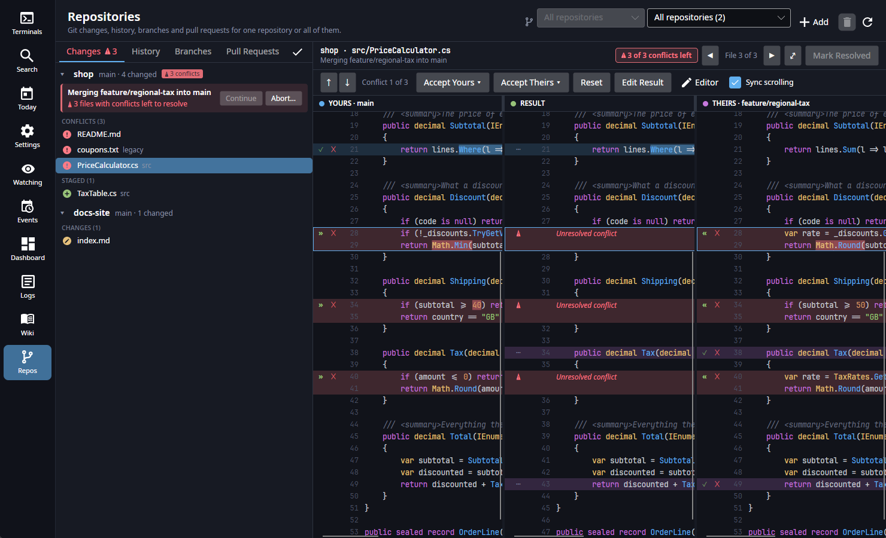

## The three-way view

Selecting a conflicted file opens the merge tool: **Yours**, **Result** and **Theirs** side by side, with line numbers
and syntax highlighting. It is built from the three versions git keeps of the file, not from the conflict markers, so
nothing is lost to a marker that was mangled. Inside a changed line, the words that actually differ are marked more
strongly than the rest of the line.

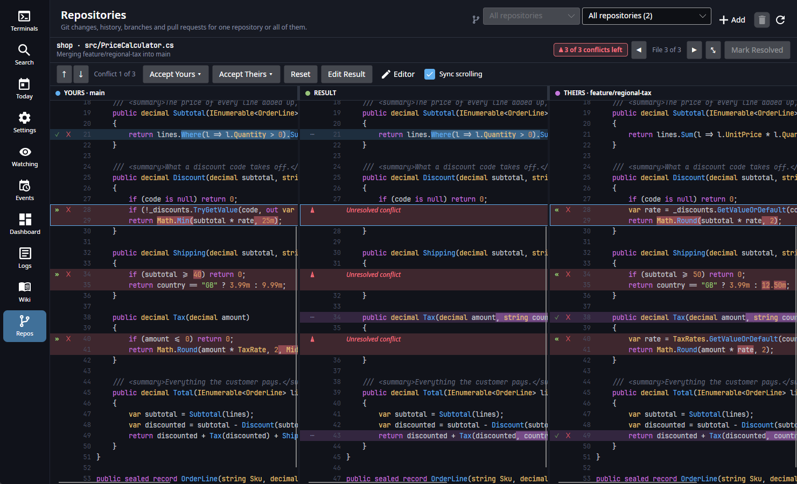

- Changes only one side made are already in the result. `✕` beside one leaves it out; `»` / `«` puts it back.
- Conflicts start open. `»` takes yours, `«` takes theirs, and taking the second side as well appends it. The mark in
  the result's margin opens a menu: both in either order, neither, or **Edit the Result Here** to type the lines.
- **Accept Yours** / **Accept Theirs** settle the conflicts still open, every conflict, or take that side's whole file.
- `↑` `↓` walk the conflicts, `◀` `▶` the conflicted files; `⤢` gives the tool the whole width.
- **Sync scrolling** keeps the three panes together; switch it off to scroll one on its own.
- **Mark Resolved** lights up once nothing is open. It writes the result, stages the file and moves to the next one.

| | |
|---|---|
| 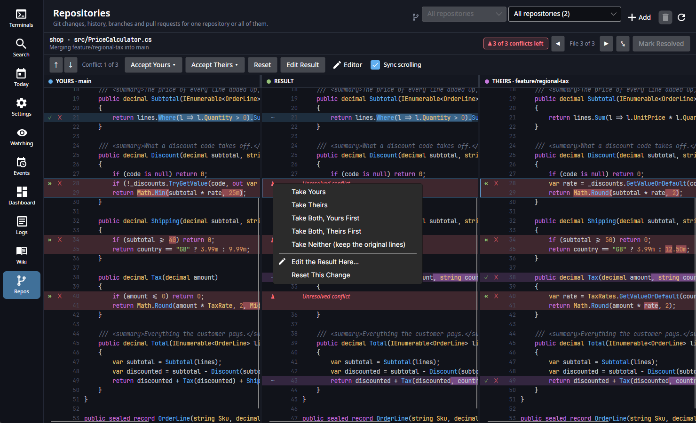 | 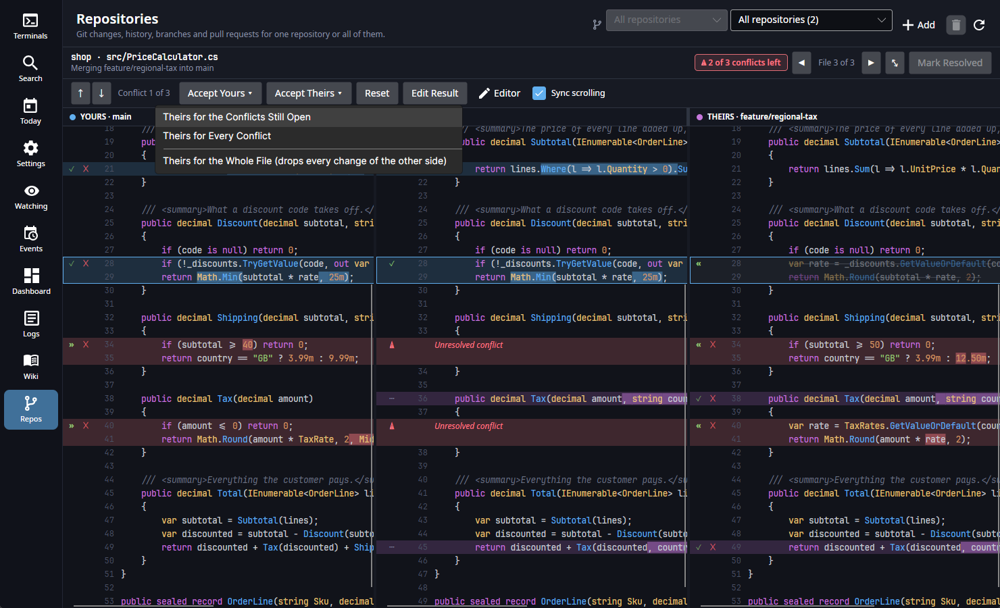 |
| 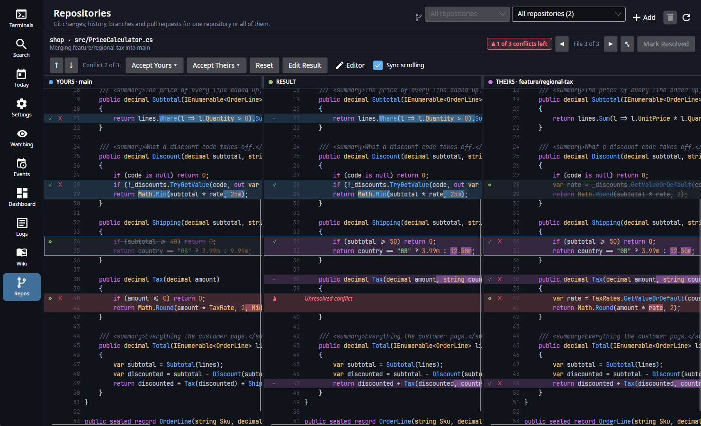 | 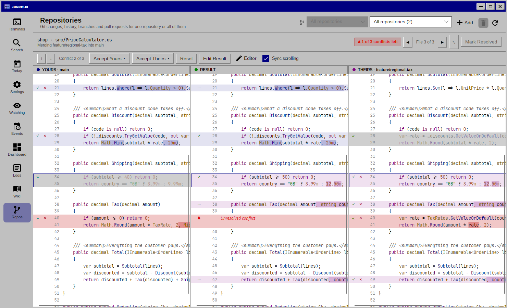 |

## Editing the result

The result can also be edited as plain text, in two ways. Either way, conflicts still open appear between git's
`<<<<<<<` / `=======` / `>>>>>>>` markers, and what you type comes back into the merge without losing anything:

- every change you did not touch keeps its decision;
- a conflict is settled once its markers are gone;
- lines you edited elsewhere become hand-made changes of their own, shown in the warning colour and undone from the
  margin menu.

The two ways:

- **Edit Result** turns the Result pane into an editor. **Done Editing** or Esc goes back to the aligned view.
- **Editor** opens the result in `repositories.editor` (vim, neovim…) in a terminal tab and links the two: each save
  there updates the Result pane, and each decision made in the tool is written to the file.

| | |
|---|---|
| 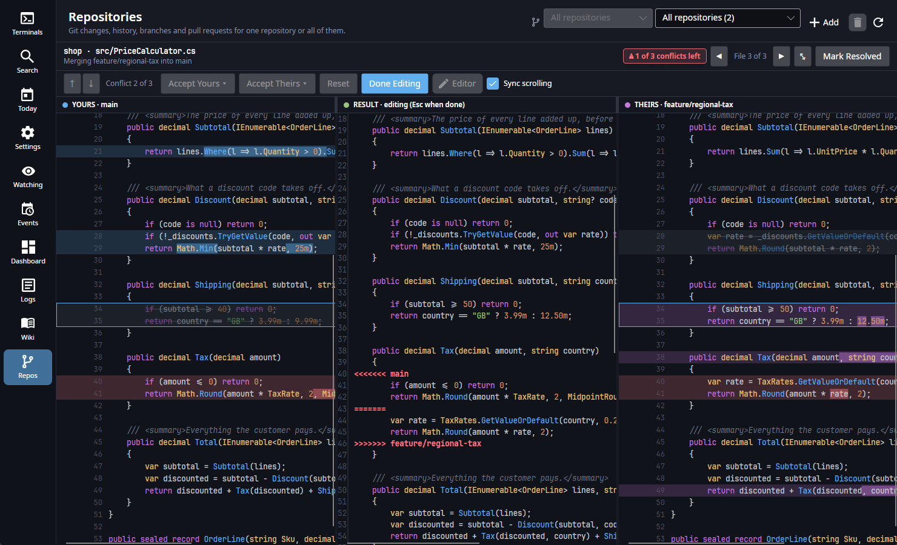 | 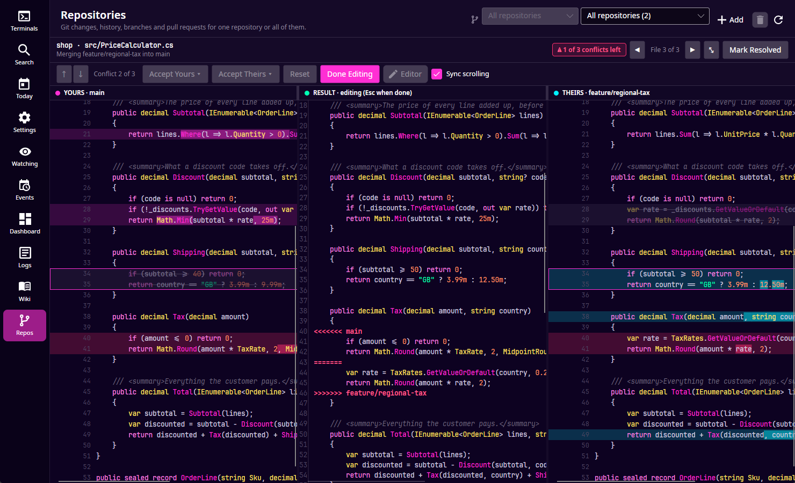 |
| 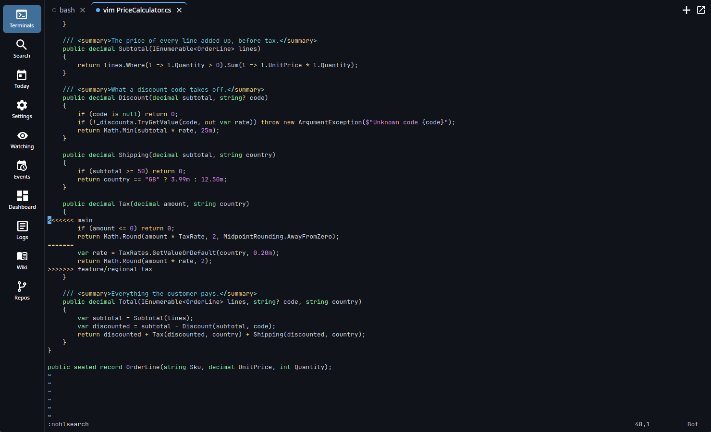 | 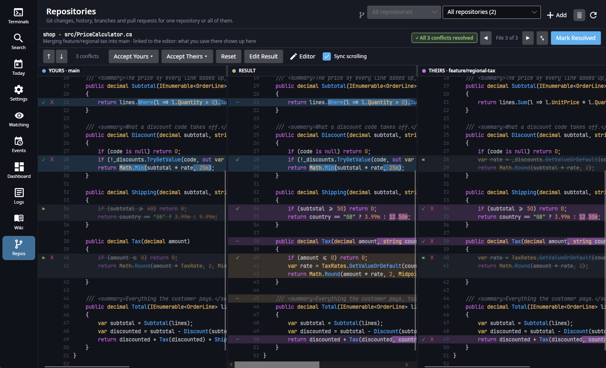 |

## Finishing

A file one side deleted, or one that is not text, offers a choice of side instead. When no conflict is left the banner
turns green and **Continue** commits the merge (or carries on with the rebase); **Abort** puts everything back.

During a rebase git's sides are swapped ("ours" is the branch being rebased onto), and the pane titles say which is
which.

| | |
|---|---|
| 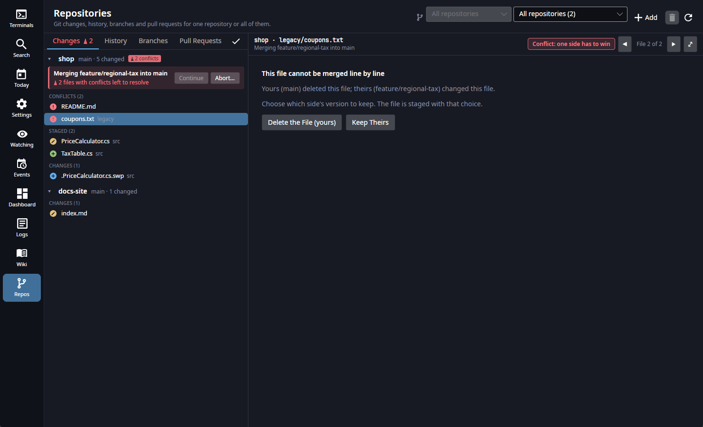 | 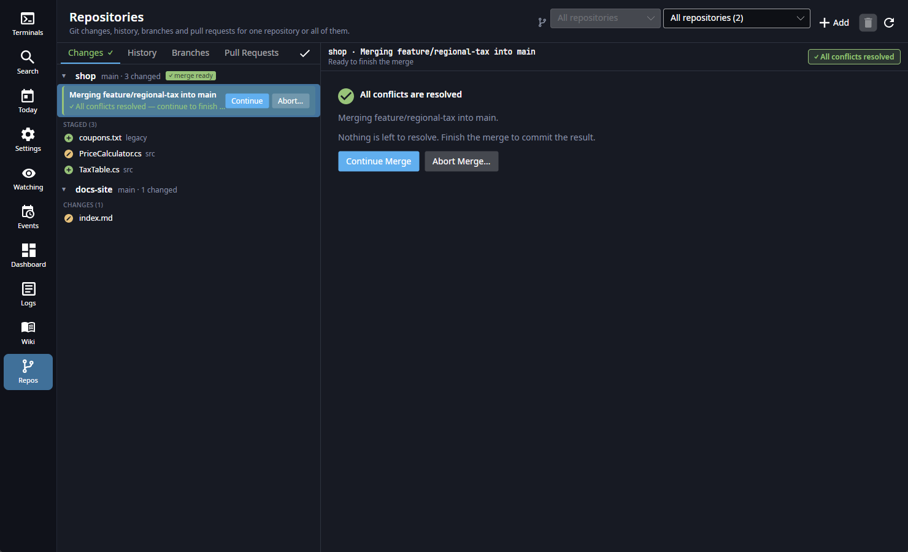 |

## Colours

The colours follow the theme: yours is the accent, theirs the theme colour furthest from it.

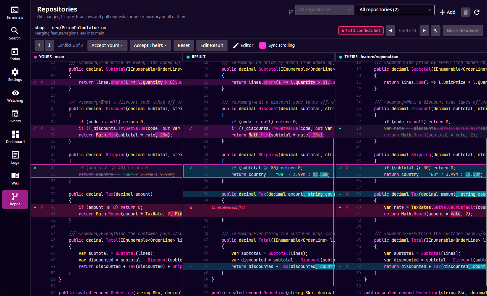
